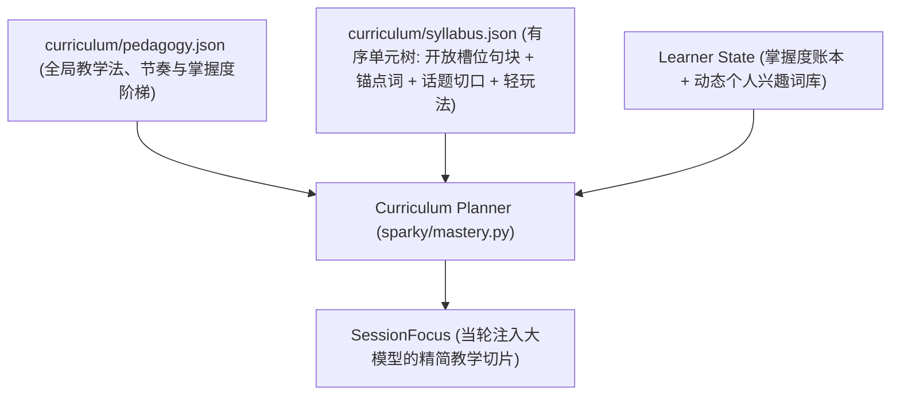
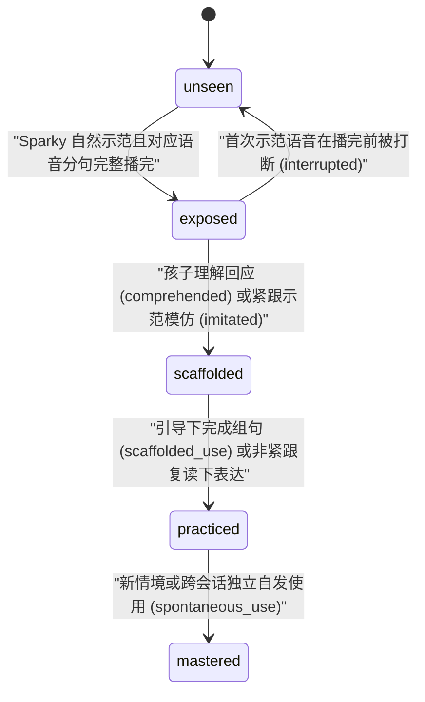
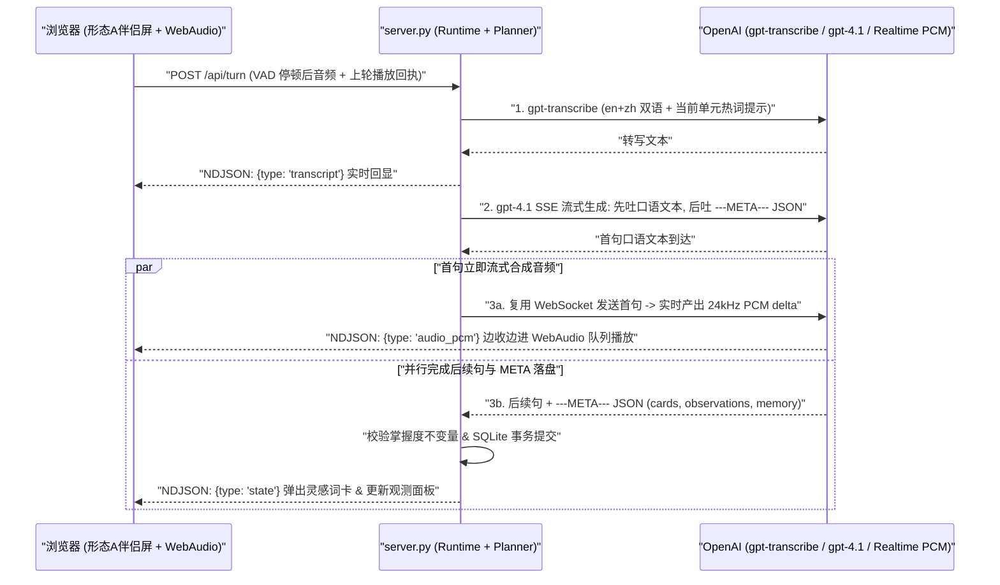

# Sparky 双语陪伴+教学伙伴：产品与架构重构设计文档（POC v2）

> 面向 **5–8 岁儿童（英语流利、中文零基础～初级）** 的内部验证原型（Demo POC）。采用 **纯语音交互为主 + 形态 A 可控伴侣屏 + 重构版 OpenAI 全流式低延迟 Cascade** 架构，重点验证 **单场自然陪伴到开口习得的闭环** 与 **跨场长期记忆延续及可配置大纲递进**。

---

## 一、重构背景与核心设计转向（Why v2）

在第一版原型（v1）基础上复盘早期教学规划与工程现状后，v2 做出以下五个根本性的设计调整：

1. **主干回归“陪伴 + 教学”双轮驱动**：
   - 日常英语陪伴聊天是伙伴关系的底色；中文词汇浸润、二选一问答、半句留白（Cloze）或 2–4 回合的轻量假装游戏（Playlets）都是**顺着聊天话头自然生长出来的交互手段**，遇阻即退，不再把整个产品做成死板的两步问答卡或孤立闯关。
2. **锚定黄金验证画像（5–8 岁 + 纯语音 + 形态 A 伴侣屏）**：
   - 避开低龄幼儿纯语音 ASR 物理瓶颈，发挥 AI 伙伴最大的错位优势——**将“内容心智成熟度”与“中文语言难度”解耦**：用英语承接 5–8 岁孩子感兴趣的恐龙、太空、搭乐高等话题，在关键互动节点引入零基础可企及的中文词句；屏幕采用可控伴侣屏（角色实时状态 + 结构化浮动双语灵感卡），既提供可理解输入的视觉锚点，又避免复杂游戏画面的不可控性。
3. **教学流从“冷抽查”反转为“输入优先（Comprehension Precedes Production）”**：
   - 废除旧版为采集“独立表达证据”而在代码层用 `forbidden_verbatim` 封禁模型中文示范的做法；统一改为 **情境自然浸润（先听见）→ 二选一 / 半句留白引导（低门槛开口）→ 情境互动复现 → 跨场日常混说滚雪球（Snowball）**。
4. **语义理解与状态边界重新分工**：
   - 废除静态字符串白名单精确匹配裁判与本地规则强制劫持（`forced_action`）。Python 运行时专注维护 **可配置大纲进度、掌握度晋升不变量与会话记忆账本**；儿童口语的意图理解与表现分级交由大模型结合上下文语义判定。
5. **根治 Cascade 语音串行延迟与静音隐患**：
   - 移除旧版“攒齐整段音频核对自转写全等、差一字即抛错静音”的脆弱校验，改为 **双语热词增强 ASR → `gpt-4.1` 两段式流式输出（首句生成即并行合成语音）→ `24kHz PCM` 边收边播 WebAudio 流管道**，配合回声消除连续收音与开口自动打断（Barge-in）。

---

## 二、可配置教学大纲数据结构设计（`curriculum/`）

教学内容与教学法完全外置为两份声明式 JSON 配置文件（支持 `python3 -m sparky check` 静态校验与运行时一键热重载），配合运行时自动维护的 **儿童个人兴趣词库（`personal_lexicon`）**。

### 2.1 三层课程数据流

### 2.2 `curriculum/pedagogy.json`：配置“怎么教”与“陪伴节奏”

控制陪伴与教学的推拉尺度、单场认知负荷上限以及 5 级掌握度阶梯允许的教学动作：

- **`session_rhythm`（单场节奏参数）**：
  - `warmup_turns`（默认 `2`）：每场开场前 N 轮优先纯英语倾听陪伴（仅可自然夹带已掌握的中文熟词），不强推新课；
  - `max_new_targets_per_session`（默认 `3`）：单场最多新引入的目标词句上限，防止信息过载；
  - `cooldown_after_decline_turns`（默认 `3`）：一旦孩子拒绝练习或倾诉情绪，自动进入纯陪伴冷却轮数；
  - `max_dynamic_personal_words_per_session`（默认 `2`）：单场允许根据孩子个人兴趣动态拓展的词卡上限；
  - `max_snowball_items_in_context`（默认 `6`）：每轮注入上下文供日常混说复现的熟词上限。
- **`mastery_stages` & `mastery_ladder`（掌握度阶梯与允许动作映射）**：

| 掌握阶段 (`stage`) | 含义 | 允许的教学动作 (`allowed_moves`) | 阶段教学目标 |
| :--- | :--- | :--- | :--- |
| `unseen` | 未接触 | `expose_in_context` | 借聊天话头自然带出中文与趣味记忆钩子，弹出词卡建立第一印象，不施压测试 |
| `exposed` | 已听过示范 | `either_or_choice`, `cloze_starter`, `recast_expand`, `playlet_turn` | 用二选一（`A 还是 B？`）或半句留白（Cloze）降低首次开口门槛 |
| `scaffolded` | 引导下可说 | `situational_invite`, `playlet_turn`, `recast_expand` | 在轻量情境中不提前喂整句答案，邀请孩子自主表达；卡壳即给提示 |
| `practiced` | 情境中会用 | `situational_invite`, `snowball_code_switch` | 隔轮新语境或下一场对话中自然检验保持与迁移；日常聊天可开始混说 |
| `mastered` | 日常熟词默契 | `snowball_code_switch` | 进入长期熟词池，在日常英文陪伴中自然夹带，作为新单元的组合积木 |

### 2.3 `curriculum/syllabus.json`：配置“教什么”与“从哪切入”

按有序单元（`units`）组织，支持前置依赖（`prerequisites`）与通关条件（`unlock_next`）：

- **`topic_bridges`**：日常英语聊天切口（如聊到宠物、恐龙、玩具时自然桥接到喜好单元）；
- **`patterns`（带开放槽位的功能句块）**：如 `你好，我是{name}`、`我喜欢{item}`、`我要吃{item}`、`这是{color}的`、`{count}个{item}`，既可填入预设词，也可填入孩子自己聊到的兴趣词；
- **`vocabulary`（核心锚点词）**：包含汉字 `zh`、拼音 `pinyin`、英文 `en`、视觉图标 `emoji`，以及专为 5–8 岁英语母语儿童设计的趣味词源/联想钩子 `hook`（如 `熊猫 = bear-cat`、`恐龙 lóng = dragon`、`冰淇淋 bīng = ice`）；
- **`playlets`（可选轻量对话游戏）**：每个单元附带 1 个无需美术资产的 2–4 回合口头小游戏模板（如神秘门铃对暗号、终极二选一挑战、神奇点心摊、探险背包点名），供聊天兴致高时按需发起，孩子换话题即刻退出。

---

## 三、运行时应用方案与核心状态不变量

### 3.1 每轮动态教学切片（`SessionFocus`）

为了避免将整套大纲塞入 Prompt 干扰陪伴质量，每轮对话前由 `sparky/mastery.py` 确定性计算精简的 `SessionFocus`：

1. **判定当前节奏档位（`rhythm_mode`）**：
   - `warmup_companionship`（热身纯陪伴）/ `cooldown_companionship`（拒绝后冷却纯陪伴）/ `english_only_requested`（明确要求纯英语）/ `bridge_ready`（可顺势搭桥教学）/ `playlet_active`（轻量小游戏进行中）；
   - 若孩子当轮明确主动询问“中文怎么说”，自动豁免热身与冷却限制。
2. **筛选当前主攻单元目标（`primary_targets`）**：
   - 按 `exposed / scaffolded` 优先于 `unseen` 的顺序，抽取当前解锁单元最多 **1 个功能句块 + 2 个锚点词汇**（连同各自当前阶段允许的 `allowed_moves`），确保“教一个、巩固一个”，不东一榔头西一棒子。
3. **装载跨场滚雪球熟词池（`snowball_familiar_bank`）**：
   - 汇集已达 `practiced / mastered` 的词句、跨场待复习词条及孩子的动态个人兴趣词，供 Sparky 在普通英文陪伴句中自然夹带混说（如 `"你好 Maya! Did your 恐龙 go on any adventures?"`）。

### 3.2 掌握度晋升与送达联动不变量

- **防复读跳级不变量**：若上一轮 Sparky 刚在回复中完整示范过某目标词句，本轮孩子紧跟着说出该中文时，即使模型在 `META` 中标记为 `spontaneous_use`，Python 状态机也会强制将其封顶修正为 `imitated`（最多推进至 `scaffolded`），保证 `practiced / mastered` 证据真实可靠。
- **播放回执回滚不变量**：首次从 `unseen` 进入 `exposed` 的词条会绑定所在语音分句索引；若前端上报该分句播放被中途打断（`interrupted`），状态自动回滚至 `unseen`，避免系统误判孩子已听过该词。
- **跨会话归档与开场生成（`Next Session`）**：结束单场会话时，`sparky/memory.py` 与 `sparky/store.py` 将本场对话提炼为结构化情节记忆（`summary`、`highlights`、`open_threads`、`practiced_zh`），并在下一场启动时结合 `snowball_familiar_bank` 主动生成有记忆延续感的双语开场白。

---

## 四、低延迟流式 Cascade 与形态 A 伴侣屏架构

### 4.1 单轮全流式时序（Sentence-Pipelined Cascade）

- **口语与展示分离规范**：Prompt 与输出清洗器严格保证 `---META---` 之前的文本是纯正自然的口语（不含括号拼音、Markdown 符号或 Emoji，避免 TTS 重复拼读拼音字母），而拼音、图标、词义与记忆钩子全部通过 `ui_cards` 结构化呈现在伴侣屏卡片上。
- **双模式收音与声学打断（`web/voice.js`）**：默认开启回声消除连续监听（短句停顿阈值约 `800–900ms`，消除旧版 2000ms 硬等待），并在 Sparky 播报期间持续监测人声能量，孩子一开口即刻停播音频、中断旧请求（`/api/cancel`）并切入新轮次录音；同时支持一键切换为「手动点击说话」以适配嘈杂演示环境。

---

## 五、代码模块映射

| 路径 | 职责 |
| :--- | :--- |
| `curriculum/pedagogy.json` | 陪伴节奏、掌握度阶梯、允许教学动作与脚手架原则配置 |
| `curriculum/syllabus.json` | 4 个递进教学单元（问候暗号、喜好表达、神奇点心铺、色彩数字与装备） |
| `sparky/curriculum.py` | 大纲加载、DAG 依赖与槽位静态校验、热词提取、卡片构建与热重载 |
| `sparky/mastery.py` | 掌握度状态机、防跳级与送达回滚不变量、动态个人词库、`SessionFocus` 调度 |
| `sparky/memory.py` | 儿童称呼与事实提取、跨场会话摘要归档与记忆快照组装 |
| `sparky/brain.py` | `gpt-4.1` SSE 流式客户端、`spoken_reply + ---META---` 增量分句解析与离线兜底 |
| `sparky/speech.py` | `gpt-transcribe` 双语热词识别 + 流式 `24kHz PCM` 语音合成与连接预热 |
| `sparky/connections.py` | Keep-Alive HTTPS 流式连接池 + 零外部依赖的内置 `StdlibWebSocket` 客户端 |
| `sparky/store.py` | SQLite 持久化（档案、预设种子、多场轮次全量日志、取消门禁与播放回执） |
| `server.py` | NDJSON 流式回合服务、开场播报、跨场推进、记忆编辑与配置热重载接口 |
| `web/index.html`, `app.js`, `voice.js`, `style.css` | 形态 A 可控伴侣屏、WebAudio 无缝 PCM 播放器、连续收音打断与右侧 POC 观测台 |
| `tests/*` | 覆盖课程校验、掌握度不变量、跨场记忆与流式语音协议的 Python & Node 测试集 |
