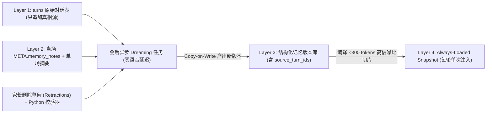

# Sparky POC v2 记忆策略与 Anthropic「Memory & Dreaming」借鉴评估

> 本文档分两部分：**第一部分**如实说明当前 `poc-v2` 已实现的记忆读写策略与真实短板；**第二部分**结合 Anthropic 关于 *Memory and Dreaming for Self-Learning Agents*（Ravi Trivedi 分享、*The Components of Agent Memory* 及 Claude Managed Agents Dreams）的核心设计，系统评估 **Sparky 应该直接借鉴什么、严禁照搬什么，以及可落地的三阶段演进方案**。

---

## 一、当前 POC v2 的记忆策略（已实现现状）

当前采用 **单儿童档案 SQLite + 滑动时间窗口 + 显式换场单次摘要**，实现入口集中在 [`sparky/memory.py`](../sparky/memory.py)、[`Store.prepare_turn_context`](../sparky/store.py#L364) 与 [`Store.start_next_session`](../sparky/store.py#L529)。

### 1.1 四类持久化数据与上下文注入窗口

| 存储层 | 写入时机与上限 | 热路径 / 开场读取方式 | 职责边界 |
| :--- | :--- | :--- | :--- |
| **原始对话日志** `turns` 表 | 每轮成功提交后写入用户文本/ASR 转写、Sparky 回复、`META`、`SessionFocus`、播放回执与耗时（不落盘原始录音）。 | 主对话注入**本场最近 8 轮**；换场在线摘要读取**本场最后 20 轮**（离线兜底读至多 50 轮）。 | 不可变流水账；旧轮次滑出窗口后留在库中但不再被检索。 |
| **关系事实列表** `memory.facts` & `child_name` | 每轮从 `META.child_name` 与 `META.memory_notes`（每轮最多取 3 条，单条 `<=120` 字）直接追加；忽略大小写全等去重，**FIFO 保留最近 16 条**；支持右侧观测台手动增删。 | 每轮对话与下一场开场固定注入 **最近 8 条**（User JSON 字段名为 `confirmed_facts`）。 | 记住名字、宠物/玩具、兴趣事件；注意尽管字段名叫 `confirmed_facts`，模型当轮提议实际会直接落库。 |
| **跨场情节摘要** `memory.episodic_summaries` | 仅在点击 `Next Session` 且本场有对话时触发 [`session_summary.md`](../sparky/prompts/session_summary.md)，产出 `summary`、`highlights`、`open_threads`、`practiced_zh`；按 `session_num` 覆盖，**保留最近 6 场**。 | 每轮对话与下一场开场固定注入 **最近 3 场**（`past_sessions`）。 | 让下一场开场（[`session_opening.md`](../sparky/prompts/session_opening.md)）能自然接上上次未完的话题。 |
| **学习记忆账本** `mastery_ledger` & `personal_lexicon` | 课程目标按曝光/回执/使用证据维护 5 级阶段；个人兴趣词每场最多新建 2 个、保留最近 24 个。 | [`compute_session_focus`](../sparky/mastery.py#L223) 挑选已达 `practiced/mastered` 或跨场待复习词条组装进 `snowball_familiar_bank`（**最多 6 个**）。 | 控制熟词滚雪球复现；摘要中的 `practiced_zh` 仅作叙事展示，绝不反向篡改掌握度账本。 |

### 1.2 当前策略在长周期运行下的四大短板

当会话场次从 2–3 场演示扩展到真实儿童连续数周（10–50 场）陪伴时，现有实现会暴露出典型的 **「实时随手记垃圾抽屉（Junk Drawer）」** 问题：

1. **事实纠错与状态变更无法闭环**：孩子先说 `"My toy fox is Blue"`，后更正 `"I meant Scout, not Blue"`，两条字符串因不完全相等会**同时留在 `facts` 列表**；系统没有 `supersedes`（覆盖关系）、置信度或来源轮次。
2. **FIFO 截断会挤出核心身份**：`facts[-16:]`（注入 `[-8:]`）纯按时间先后淘汰。孩子某天连续分享了 8 件当天琐事（午饭吃了面条、画了消防车……），最早录入的**核心稳定画像**（如家里养的金毛犬名字、最爱的霸王龙玩偶）就会滑出注入窗口。
3. **未完话头（`open_threads`）缺少核销机制**：第 2 场留下的 `"打算给恐龙画银星"` 在第 3 场已经聊完，但因为 `past_sessions[-3:]` 静态照搬旧摘要，第 4、第 5 场开场仍可能反复追问同一件旧事。
4. **缺少「这个孩子怎么教最舒服」的跨场经验沉淀**：当前只记了「聊过什么事实」和「哪个词到第几级」，完全没沉淀跨多场才能看出的**个体教学交互规律**（例如：该儿童遇到开放式提问容易沉默，但对二选一怪兽扮演响应极高；或者孩子发某个音常被 ASR 误识为固定同音词）。

---

## 二、Anthropic「Memory and Dreaming for Self-Learning Agents」核心机制拆解

在 Ravi Trivedi 的分享（[YouTube: Memory and dreaming for self-learning agents](https://www.youtube.com/watch?v=IGo225tfF2I)）以及配套技术文档（[*The Components of Agent Memory*](https://www.anthropic.com/research/components-of-agent-memory)、Claude Managed Agents *Dreams*）中，Anthropic 针对长周期 Agent 提出了两个核心思想：

1. **四层记忆分层架构（避免把原始笔记直接当常驻 Prompt）**：
   - **Layer 1 · Raw Transcripts（不可变原始逐字稿）**：只追加不修改的事实真相源（对应 Sparky 的 `turns` 表）。
   - **Layer 2 · Working Notes（会话内随手记）**：热路径中低成本记下的临时观察与笔记（对应 `META.memory_notes` 与单场 `episodic_summaries`），允许粗糙、重复甚至偶有偏差。
   - **Layer 3 · Derived / Consolidated Store（整理后的结构化知识层）**：跨多场归并后的实体档案、偏好与经验规则。
   - **Layer 4 · Always-Loaded Context（极简常驻上下文）**：每轮自动注入模型的顶层高信噪比摘要。Anthropic 实验表明，**约 10 条精炼准确的常驻记忆远胜于数百条未整理的笔记堆积**——因为常驻层里只要混入一条过期或错误笔记，就会污染后续每一轮生成。
2. **Dreaming（离线睡眠期记忆巩固 / Sleep-Time Compute）**：
   - **热冷路径彻底解耦**：不在用户实时交互时耗费延迟和注意力去维护复杂记忆库，而是在会话结束后的空闲期（Out-of-Band / Offline）运行后台整理任务。
   - **回溯原始记录纠偏与跨场模式发现**：Dream 任务同时读取「当前记忆库 + 最近一批原始会话逐字稿」，对照原话修正实时笔记中的误判、合并重复、淘汰过期矛盾条目，并提炼单场视角看不出来的**跨场行为模式（Self-Learning）**。
   - **写时复制（Copy-on-Write）安全产出**：Dreaming **不原地覆盖**原始记录或正在服役的记忆库，而是产出一份可校验、可审阅、可一键回滚的**新版本记忆快照**。

---

## 三、深度评估：Sparky 是否可以采用或参考？

**核心结论：非常值得参考其「四层记忆分层 + 会后异步 Dreaming 巩固 + 版本化快照」范式，但绝不能原样照搬 Coding Agent 的自由文件自修改模式——必须做「三取三舍」的儿童语音产品化改造。**

### 3.1 强烈建议借鉴的三个设计点（三取）

1. **取「会后异步 Dreaming（Sleep-Time Compute）」——天然契合儿童会话节律与严苛语音延迟**：
   - 5–8 岁儿童单次语音陪伴通常只有 `5–15 分钟`，两场对话之间天然存在数小时到隔夜的“睡眠间隔”。
   - 把记忆去重、矛盾覆盖（`Blue -> Scout`）、未完话头核销（`open_thread -> resolved`）完全移出 `POST /api/turn` 热路径，放到**会话结束/闲置超时后异步执行**，不仅对实时语音首包延迟**零负担**，甚至还能减轻主对话模型在 `---META---` 中写笔记的负担。
2. **取「常驻层极简高信噪比（Layer 4 槽位化）」——根治 FIFO 挤出与过期追问**：
   - 将目前一锅炖的 `confirmed_facts[-8:]` 升级为由 Dreaming 维护的定长结构化槽位（总计严格控制在 `<300 tokens`）：
     - `core_profile`（核心稳定画像，最多 6 条：昵称、宠物/重要玩偶、长期痴迷主题——**不随日常琐事 FIFO 淘汰**）；
     - `active_threads`（最多 2 条**尚未闭环**的近期事件/待追问话头；一旦下场聊过即由 Dreaming 标记 `resolved` 移出常驻层）；
     - `recent_episodes`（最近 2 场精简摘要）。
3. **取「跨场模式提炼（Self-Learning）」——但聚焦于『个体陪伴与脚手架偏好画像』**：
   - 单轮模型看不出长期规律，而跨 3–5 场 `turns` 的 Dreaming 可以提炼出极有教学价值的 **`learner_persona`（受控枚举/短标签）**：
     - `effective_hooks`：哪些话题切口最能点燃这个孩子开口（如 `"太空救援扮演"`、`"恐龙战力对比"`）；
     - `preferred_scaffolds`：这孩子更吃 `either_or_choice` 还是 `cloze_starter`，什么情况下容易退缩；
     - `asr_aliases`：该儿童常见发音/ASR 同音偏差提示（可反哺 `asr_hotwords` 或语义观察容错）。

### 3.2 面向儿童实时语音产品绝不能照搬的三个禁区（三舍）

1. **舍「自由 Markdown 文件树 + 运行时工具翻找记忆」**：
   - Anthropic 面向编程/办公 Agent 的方案常把记忆存成目录树（如 `MEMORY.md` + 多篇 Wiki），让 Agent 在任务中按需调用工具查阅。
   - Sparky 单轮语音回复预算在 `1 秒` 量级，**绝不能在热路径引入多轮工具检索**；所有整理必须在会后 Dreaming 阶段预编译成固定 Schema 的轻量 JSON，热路径保持「一次查询直注、单流 SSE 直出」。
2. **舍「自学习直接改写系统提示词、安全红线或掌握度账本」**：
   - 在通用自学习 Agent 中，Dreaming 会自己总结行为准则改写指令。但在儿童教育产品中，**安全转介规则（受伤/危险找大人）、大纲前置依赖、`unseen -> mastered` 晋升门槛与防复读跳级不变量必须 100% 由 Python 代码硬控**，严禁 Dreaming 越权修改教学状态机或系统 Prompt。
3. **舍「无墓碑的全量历史重扫」——必须补齐『家长删除墓碑（Tombstone）』与儿童隐私过滤**：
   - **工程陷阱**：如果家长在面板删除了某条事实（例如涉及家庭隐私或孩子不再想提的事），而下一次 Dreaming 又去扫描最近 10 场原始 `turns` 逐字稿，模型会把已删事实**重新“做梦”提炼回来**！
   - 因此，任何手动删除操作都必须写入 `memory_retractions` 墓碑表（或同步脱敏对应 `turns`），Dreaming 产出的候选条目必须经过 Python 墓碑黑名单与隐私规则（禁存家庭住址、学校全称、家人真实全名、联系方式）双重过滤后才能发布。

---

## 四、建议的分阶段落地路线图（P0 → P2）

不需要推翻现有架构，可以沿以下三步平滑演进，并用 [`evaluations/`](../evaluations/README.md) 定量验收：

### P0：最小侵入升级结构化事实与删除墓碑（无需后台任务即可先修核心 Bug）
- **改动点**：在 `memory.facts` 每条记录上增加 `category`（`core` | `episodic`）、`source_turn_id`、`status`（`active` | `superseded` | `retracted`）；`context_snapshot` 优先保留 `core` 类活跃条目，避免核心兴趣被日常琐事挤掉；`remove_fact` 改为标记 `status = "retracted"`，防止同一文本被重复写入。
- **扩展 `META` 可选字段**：允许主对话在孩子明确纠错时输出 `supersede_fact`（或在换场摘要时顺带合并矛盾事实）。

### P1：在 `Next Session` / 会话闲置超时引入轻量级 Copy-on-Write Dreamer
- **触发方式**：把当前 `start_next_session` 中的同步单场摘要，升级为（或在会话结束后后台异步触发）读取「当前活跃记忆快照 + 最近 3 场原始 `turns` + `retracted` 墓碑列表」的 **`dream_consolidate`** 任务。
- **版本化落库**：新增 `memory_snapshots(version, profile_id, created_at, snapshot_json, diff_json)` 表。每条新事实/覆盖操作必须附带真实存在的 `source_turn_id`（Python 校验该 `turn_id` 确实属于当前 `profile_id`，从根源阻断跨档案串味与无中生有）。校验通过后原子更新当前生效指针，异常时自动保留上一版快照。
- **自动核销 `open_threads`**：Dreamer 对比上场 `open_threads` 与本场对话，已聊过的话题自动归档为 `resolved`，不再塞入下场开场。

### P2：跨场「个体学情偏好（Learner Persona）」自学习与评测闭环
- **受控自学习切片**：每隔 3–5 场会话，Dreamer 统计 `turns` 中各 `move` 下的儿童响应率（如 `either_or_choice` 开口率 vs `situational_invite` 退缩率、最常触发积极长句的话题词），生成不超过 3 条结构化 `coach_hints` 注入 `SessionFocus`。
- **在 `evaluations/` 中同步配套的 5 类自动化验收指标**：
  1. **事实更正率**：多次改名/改偏好后，新快照与开场白只保留最新值、零旧值残留；
  2. **核心画像抗冲刷率**：连续插入 12 轮日常闲聊琐事后，第 1 场录入的宠物/核心兴趣仍在 `context_snapshot` 中；
  3. **墓碑防复活率**：手动删除某事实后再跑 Dreaming 重扫历史对话，该事实不会重新浮现；
  4. **证据可追溯率**：100% 巩固事实具备有效本档案 `source_turn_id`，零跨档案泄漏、零未发生事件脑补（如“打算画银星”不被记成“已画完”）；
  5. **常驻上下文体积**：连续 20 场会话后，每轮注入模型的 `memory` JSON 稳定维持在 `<300 tokens`。
