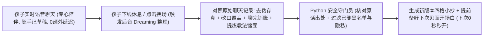

# Sparky 长期记忆与自学习升级方案（借鉴 Anthropic Memory & Dreaming）

> **一句话看懂本方案**：
> 现在的 Sparky 就像一边陪孩子聊天、一边往一张只有 16 行的小便签上随手抄笔记——聊久了，重要信息会被日常琐事挤掉，孩子改口纠正的事会新旧打架，聊完的话题还会反复追问。
> 借鉴 Anthropic 最新的 **「记忆分层 + 会后做梦整理（Dreaming）」** 机制后，我们的做法变成：**陪孩子说话时只管专心回应、随手记草稿（0 延迟）；等孩子下线休息后，系统在后台像人睡觉整理记忆一样，对照聊天原话去重、纠错、划掉已聊完的话题、总结“这个孩子最吃哪套教法”，并提前备好下次见面的第一句招呼。**

---

## 一、现状诊断：现在的记忆为什么聊久了会“露怯”？

目前项目的记忆逻辑（[`sparky/memory.py`](../sparky/memory.py)）非常轻量：每聊完一轮，模型顺手吐出 1–2 条笔记，直接塞进一个最多存 16 条的列表里，每次对话只取最新的 8 条给模型看。

演示两三场时完全够用，但如果真让一个孩子连续聊上两周，就会出现 **4 个非常影响伙伴感的问题**：

1. **孩子改口纠正了，系统却“新旧一起记”**
   比如孩子先说 *“我的玩具狐狸叫 Blue”*，下一句改口说 *“说错了，它叫 Scout”*。现在的系统因为两句话字面不一样，会把两条都留在本子里，下次开场很可能还会叫错名字。
2. **重要的长期信息，会被当天的吃喝小事挤掉**
   现在的列表纯粹按“先来后到”排队淘汰。假如第 1 天记下了 *“家里养了只金毛犬叫豆豆”*，第 3 天孩子兴奋地连聊了 8 件小事（午饭吃了面条、看见消防车、画了太阳……），最重要的“金毛犬豆豆”就被挤出每轮必看的 8 条窗口，Sparky 突然“失忆”了。
3. **明明已经聊完的事，后面几场还在像复读机一样问**
   上一场结束时记下了一个待追问话头（比如 *“下次问问给恐龙画没画银星”*）。哪怕今天一开场就已经聊完了，因为最近 3 场的摘要是原样照搬进提示词的，后天、大后天 Sparky 可能还会接着问银星画没画完。
4. **只记住了“聊过什么词”，没学会“怎么教这个孩子最管用”**
   现在的系统知道孩子学到了第几单元，但不会跨场总结经验——比如 *“这个孩子一遇到直接提问就害羞沉默，但只要给二选一扮演游戏就抢着开口说中文”*。每次重开一场，还得重新试探孩子的脾气。

---

## 二、Anthropic 的思路好在哪？（用大白话讲透）

Anthropic 在《Memory and dreaming for self-learning agents》分享中，解决的正是长周期 AI 助手“笔记越记越乱、越用越笨”的问题，核心只有两个朴素的道理：

1. **「随手记的草稿」和「上场必带的小抄」必须彻底分开**
   聊天当下根本来不及判断哪句话一个月后还重要。如果把未经整理的随手记全塞进提示词，不仅占地方，只要混进一条错漏过期的信息，就会干扰后面的每一次回答。真正每轮带进脑子里的“小抄”，必须极度精炼、分类清晰。
2. **「干活时不整理房间，睡觉时再回看录像整理」（Dreaming 机制）**
   人类是在夜里睡觉时，把白天的零碎经历去粗取精、转化为长期记忆并总结经验的。AI 也一样：**实时互动时争分夺秒保证响应快；等会话结束后的空闲期，后台再把聊天原话翻出来核对整理**，而且是“先抄出一份干净的新记忆本，检查无误后再替换旧本子”，绝不把原记录改坏。

---

## 三、Sparky 记忆升级四大模块

### 模块 1：把“一张便签纸”升级为「四层记忆漏斗」

借鉴 Anthropic 的四层隔离原则，把当场草稿与每轮必读记忆彻底拆开：

| 层级 | 通俗比喻 | 在 Sparky 里存什么 | 怎么用 |
| :--- | :--- | :--- | :--- |
| **第 1 层：原始录像带** | 监控回放 | 现有的 `turns` 对话表（每轮原话、动作、语音播完没） | 只追加不修改，作为后台核对真假的唯一依据。 |
| **第 2 层：随手草稿箱** | 便利贴暂存盒 | 聊天时模型随手记下的候选点子（`candidate_notes`） | **只进草稿箱，不再直接当成既定事实**，聊天更快更轻。 |
| **第 3 层：版本档案柜** | 带编号的正式档案 | 后台整理核实后的结构化记忆快照（`memory_snapshots`） | 每条记忆都记着“出自哪句原话”，出问题随时可退回上一版。 |
| **第 4 层：上场四格小抄** | 放进口袋的精华卡 | 每次对话真正发给大模型的精简内容（总长不超过 280 词） | 拆成下面 **4 个固定格子**，互不抢位置。 |

**第 4 层「上场四格小抄」包含哪四格？**
1. **核心档案（最多 6 条）**：孩子昵称、宠物、最心爱的玩偶、长期痴迷的主题——**拥有独立专座，今天聊再多吃喝琐事也挤不掉它**。
2. **待追问小尾巴（最多 2 条）**：上次没聊完、值得下次关心一下的事（一旦聊过立刻划掉）。
3. **最近两场回顾（最近 2 场）**：各用一句话概括前两次聊了什么，保持连贯感。
4. **专属教学锦囊（最多 3 条）**：怎么引导这个孩子开口最顺手（详见模块 3）。

---

### 模块 2：引入「会后自动整理（Dreaming）+ 提前备好下次开场白」

5–8 岁孩子每次通常只聊 5–15 分钟，聊完关掉页面（或静置超时）就是天然的后台“做梦整理”时间，**对实时语音速度零拖累**。

1. **什么时候触发**：会话结束/闲置超时后台自动跑一次（在演示台点 `Next Session` 也可触发）。
2. **后台读取什么**：`当前生效的记忆快照` + `刚聊完的原始对话记录` + `家长删除黑名单`。
3. **一次后台整理自动干完 4 件事**：
   - **去伪存真（剥离游戏台词）**：对照前后文，分清哪些是孩子真实生活里的事（“我家小狐狸玩偶叫 Scout”），哪些只是刚才过家家游戏里的玩笑话（“我是银河海盗船长”），后者不进长期档案。
   - **改口自动覆盖（不再新旧并存）**：识别出孩子改口纠正（如 *“叫 Scout，不是 Blue”*），把旧条目标为“已过期（`superseded`）”，只让最新、最准的信息上小抄。
   - **聊完的话题自动销账**：检查上次留的“待追问小尾巴”这回聊了没——聊过了就标“已完结（`resolved`）”撤下小抄；如果连着 3 场孩子都没兴趣提，也自动收起，绝不当烦人的复读机。
   - **提前备好下次见面的第一句话（体验大加分）**：现在点换场要现场调两次大模型，等好几秒；升级后，后台整理结束时顺手把下一场（`Session N+1`）的双语招呼语和词卡提前生成好存进库里。**下次孩子一打开页面，0 秒等待，Sparky 立刻开口叫出名字打招呼。**
4. **Python 代码最后把一道安全关**：
   后台模型整理出的新记忆不能直接生效——Python 代码会逐条检查它标注的“原话编号（`source_turn_ids`）”是不是真的存在于这个孩子的聊天表里（彻底防瞎编、防不同孩子串档）。检查全过才切换到新版本；万一网络波动或格式出错，自动稳稳沿用上一版记忆。

---

### 模块 3：借鉴「自学习（Self-Learning）」提炼专属教学锦囊（`coach_playbook`）

Anthropic 视频里最亮眼的设计，是让 AI 从多次历史经历里自己总结“怎么配合更少踩坑”。放到儿童教育产品里，**我们绝不允许 AI 自己乱改安全红线或降低课程过关标准**，但非常适合让它总结 **「这个孩子最吃哪一套互动方式」**：

- **一半靠 Python 算真实数据（客观不瞎猜）**：
  代码直接统计这个孩子在过去几场里，面对“趣味二选一”“半句留白接龙”“开放式提问”“角色扮演小游戏”这几种教法时，哪一种开口成功率最高、哪一种最容易说“不想玩了”。
- **一半靠后台归纳成最多 3 条「专属教学锦囊」**（每隔 2–3 场更新一次，塞进每轮教学提示里）：
  1. **引导方式偏好**：例如 *“这孩子遇到直接提问容易卡壳，先给趣味二选一热身几乎每次都愿意接话”*；
  2. **高共鸣话题切口**：例如 *“只要把生词套进‘给恐龙打造新装备’的故事里，参与度最高”*；
  3. **专属发音/听音小贴士**：记下这个孩子发音容易被语音识别听混的固定词，自动补充进他个人的语音识别热词表（`asr_hotwords`），让系统越来越听得懂他。

---

### 模块 4：加上儿童产品必备的「彻底遗忘黑名单」与隐私过滤

这是把通用 AI 记忆方案用到儿童产品上必须补齐的一把安全锁：

- **删掉就彻底忘掉，做梦也不会再翻出来**：
  如果家长或测试人员在面板上删掉某条记忆，不能只是从当前列表里拿掉——否则下次后台重看历史聊天记录时，又会把它重新总结出来。升级后，删除操作会记入一张 **「已删除黑名单（删除墓碑 `retractions`）」**，后台以后无论怎么整理，只要撞上黑名单一律自动过滤。
- **敏感隐私不落盘**：
  Python 守门员自动拦截具体家庭住址、电话号码、学校全称等敏感信息，只记童趣偏好，不攒家庭隐私。

---

## 四、保持克制：明确「不做什么」（不花冤枉钱、不拖慢语速）

为了保证系统简单好维护、说话反应快，以下三件事我们**明确不做**：

1. **不做“边说话边翻文件夹查记忆”**
   写代码的 AI 可以让用户等五秒钟去翻几百个文档；但陪 5–8 岁孩子语音聊天，停顿超过 1 秒孩子注意力就跑了。所以我们坚持 **“后台提前整理好四格小抄 → 聊天时一次性直接读入”**，绝不在说话中途加查询步骤。
2. **不上复杂的向量数据库（Vector DB）**
   一个孩子几十场聊天真正需要长期记住的精华信息非常浓缩，280 词以内的“四格小抄”比大海捞针式的向量检索更准、更可控，而且继续保持现在 **“零外部组件依赖、一个本地 SQLite 文件全搞定”** 的极简架构。
3. **不让后台记忆整理去改「单词掌握度账本」**
   一个词到底算“刚听过”还是“真学会了”，依然 100% 由实时对话表现和“那句示范语音有没有真的播完”的代码硬规则决定，保证教学进度真实可信。

---

## 五、建议怎么分步落地？（三步走，风险最小）

整套方案不需要推翻现有代码，完全可以分三个独立小步稳妥推进，每一步都能用现有的自动化 Eval 集直接跑分验证：

| 阶段 | 做什么 | 立竿见影解决什么问题 |
| :--- | :--- | :--- |
| **第一步：升级“四格小抄”与删除黑名单** *(改动最小，约 0.5–1 天)* | 先不搞后台线程，直接把记忆结构拆成“核心档案 + 待追问小尾巴 + 草稿箱 + 删除黑名单”，挂在现有的换场节点跑通合并。 | 立刻解决 **改口新旧打架、重要设定被琐事挤掉、聊完的话题反复问、删掉又冒出来** 四个核心痛点。 |
| **第二步：切入后台异步整理 + 预备开场白** *(体验升级)* | 新增版本化记忆快照表与后台整理任务，加上 Python 原话出处核验，并提前生成好下一场开场白。 | **换场和重进页面实现 0 秒秒开直接打招呼**，且记忆更新安全可回退。 |
| **第三步：加上“专属教学锦囊”自学习** *(越聊越懂孩子)* | 接入跨场教学动作成功率统计与 3 条锦囊归纳，并在自动化评测集中补齐专项验收题。 | Sparky 开始真正**因材施教**，越往后聊越懂怎么顺着这个孩子的性子引导开口。 |
